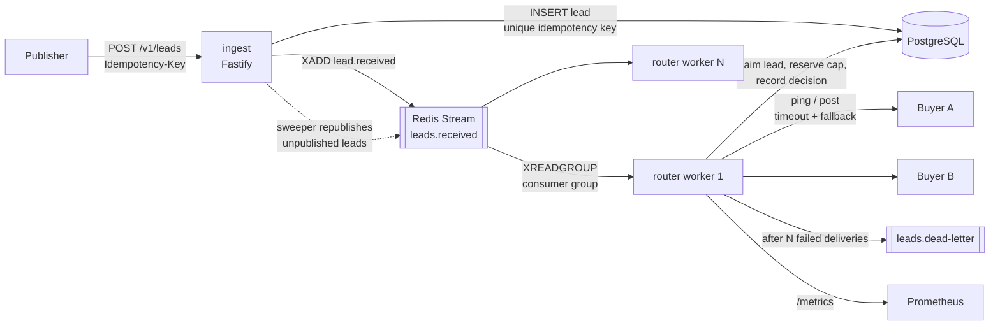

# lead-routing-engine

An event-driven engine that routes inbound consumer leads (loan or insurance enquiries) to the best
eligible buyer, in a ping-post flow, within a latency budget, without ever selling the same lead twice
or letting a buyer exceed their cap, under concurrent load.

> **Status: in progress, built in public.** The design below is the target; the [roadmap](#roadmap)
> says what is actually implemented. Numbers in this README are only ever measured ones. Anything not
> yet measured or validated says so.

## The problem

A lead marketplace receives enquiries from publishers and sells each one to a single buyer. Buyers
configure:

- **Filters**: which leads they want (US state, requested amount range, credit band, product).
- **Price**: what they pay per lead. Higher-paying buyers are tried first.
- **Caps**: maximum leads per day and per hour. Overselling a cap is a billing dispute.
- **Schedules**: the hours, in their own time zone, during which they accept leads.
- **Weight**: how traffic is shared between buyers that pay the same price.

A lead is worth most in the first seconds after submission, so routing has a latency budget. Buyer
endpoints are slow or unreliable, so every call to one has a timeout and a fallback to the next buyer.
The hard requirements are business ones:

1. A publisher retrying a request must not create a second lead.
2. A lead is sold **at most once**, and every accepted lead eventually reaches a final state
   (sold, unsold, or dead-lettered for a human).
3. A buyer's cap is **never exceeded**, even with many router workers running concurrently.

## Architecture

| Component | Responsibility |
|---|---|
| `services/ingest` | Validates the lead (zod), enforces the idempotency key, persists the lead, publishes `lead.received`, answers `202 Accepted`. |
| `services/router` | Consumer-group worker. Claims a lead, finds eligible buyers, orders them, reserves cap, pings/posts with timeouts, records the decision, acks. Retries with backoff; dead-letters after N deliveries. |
| `packages/shared` | Lead schema, config, logging, Postgres/Redis clients, migrations. |
| PostgreSQL | Source of truth: buyers, leads, cap counters, routing decisions. |
| Redis Streams | Work queue between ingest and routers (consumer groups, pending entries list, DLQ stream). |

## Routing algorithm

For each lead the router:

1. **Claims** the lead with a conditional `UPDATE ... WHERE status = 'received' OR lease expired`.
   A duplicate stream message, or a second worker, finds nothing to claim and acks.
2. **Filters** buyers: active, inside their schedule (evaluated in the buyer's time zone), and matching
   every filter on the lead.
3. **Orders** candidates: by price descending; within an equal price, a weighted random shuffle
   (Efraimidis-Spirakis keys `u^(1/w)`), so a buyer with weight 3 is first three times as often as one
   with weight 1. The random source is injected, so tests are deterministic.
4. **Walks the list**. For each candidate: atomically reserve a slot in its hourly and daily cap
   counters (a conditional upsert that fails when the cap is full), ping/post with a timeout, and
   either commit the sale or release the reservation and move on to the next buyer.
5. **Records** the decision (sold to X at price P, or unsold with the reasons each buyer was skipped)
   and acks the stream message.

## Guarantees

| Guarantee | How |
|---|---|
| Publisher retries don't duplicate leads | `Idempotency-Key` header is unique in Postgres. A replay returns the original lead id; the same key with a different payload is a `409`. |
| No lead is lost between Postgres and Redis | The `leads` table doubles as the outbox: a lead is `published_at IS NULL` until `XADD` succeeds, and a sweeper republishes stragglers. |
| Delivery to the router | At-least-once: messages are acked only after the decision is committed; unacked messages are reclaimed. |
| Each lead sold at most once | Idempotent consumer: lead claim with a lease + a partial unique index on `routing_decisions(lead_id) WHERE outcome = 'sold'`. At-least-once delivery + idempotent consumer = **effectively-once** from the business's point of view. |
| Caps never exceeded | Cap counters are reserved with a single-statement conditional upsert in Postgres, so concurrent workers serialize on the counter row. A crash between reserve and release can *under*-fill a cap, never overfill it. |
| Poison messages don't block the stream | Retries with exponential backoff (based on idle time and delivery count), then the message moves to a dead-letter stream and the lead is marked `failed`. |

What is deliberately **not** guaranteed: exactly-once *delivery* (nobody has that; we de-duplicate
instead), and exactly-once calls to buyer endpoints (a crash after a buyer accepted but before the
decision is committed can lead to a second post on retry; buyers receive the lead id so they can
de-duplicate, which is the standard contract in ping-post integrations).

Design decisions and their trade-offs are in [`docs/adr/`](docs/adr):

- [ADR-0001: Redis Streams instead of Kafka](docs/adr/0001-redis-streams-over-kafka.md)
- [ADR-0002: Cap enforcement with conditional upserts in Postgres](docs/adr/0002-cap-enforcement.md)
- [ADR-0003: Idempotency and effectively-once processing](docs/adr/0003-idempotency-effectively-once.md)
- [ADR-0004: Ping-post timeouts and fallback](docs/adr/0004-ping-post-timeouts-fallback.md)

## Roadmap

| Milestone | Scope | Status |
|---|---|---|
| M0 | README, ADRs, licence | Done |
| M1 | npm-workspaces monorepo (TS strict, ESLint, Vitest), ingest service with validation and idempotency, Postgres migrations, docker-compose, CI with integration tests against Postgres and Redis | Planned |
| M2 | Router worker: eligibility filters, atomic caps, tier + weighted selection, consumer group with ack / retry / DLQ, idempotent processing, concurrency tests | Planned |
| M3 | Ping-post over HTTP with timeouts and fallback (mock buyer server), Prometheus metrics, k6 load test | Planned |
| M4 | Kubernetes manifests (kustomize), HPA on stream lag, load test results in this README | Planned |
| M5 | Cap reconciliation job, buyer admin API, OpenTelemetry tracing | Planned |

## Load test results

Not yet run. This section will hold the k6 scenario, the hardware it ran on, and the measured
throughput and latency percentiles once M3 lands.

## Licence

[MIT](LICENSE) © 2026 Adil Khan
